# CEDAR 3 Controlled Term Tutorial

When you design a template field, you decide what its values are allowed to be,
and the most valuable thing you can do is tie those values to terms that already
exist in a shared vocabulary. This tutorial is a close look at how CEDAR lets you
do that. It assumes you have done the basic [CEDAR 3 Tutorial](cedar3_tutorial.md)
and can already create a folder, design a template, and add fields.

The weakest way to define a field is to leave it as free text. Two people then
write "kidney", "Kidney", and "renal", and no program can tell they mean the same
thing. CEDAR instead lets you constrain the field to terms drawn from an ontology
repository, so every value someone enters is a real, resolvable identifier that
means the same thing to everyone and to every program. CEDAR draws terms from
[BioPortal](https://bioportal.bioontology.org), an open repository of biomedical
ontologies, and from other sources of controlled vocabularies and value sets.

There are three ways to point a field at BioPortal terms, and they differ in how
much you reuse and how much you assemble yourself. You can bind the field to an
entire ontology, to a single branch of one, or to a set of individual classes you
choose one at a time. They run from the most reuse to the most bespoke, and that
is the order this tutorial follows. A fourth approach uses a *value set*: a named
list of allowed values maintained for a particular purpose. You will use EPA's
PFAS method lists to try that approach too.

One thing this tutorial deliberately shows is that the right term rarely just
appears. BioPortal holds hundreds of ontologies, the same word names different
things in many of them, and the concept you want is often buried deep inside a
large ontology rather than sitting at the top. Finding it takes searching,
narrowing, and judgment.

You will build **Tissue Sample** with three kinds of ontology constraint, then
**PFAS Test** with value-set constraints. You need a CEDAR account and about
30 minutes.

## Start the Template

Open [**workspace.metadatacenter.org**](https://workspace.metadatacenter.org) and sign in.
Create a folder to work in, open it, and choose **New → Template**. Name the
template `Tissue Sample` and give it a short description.

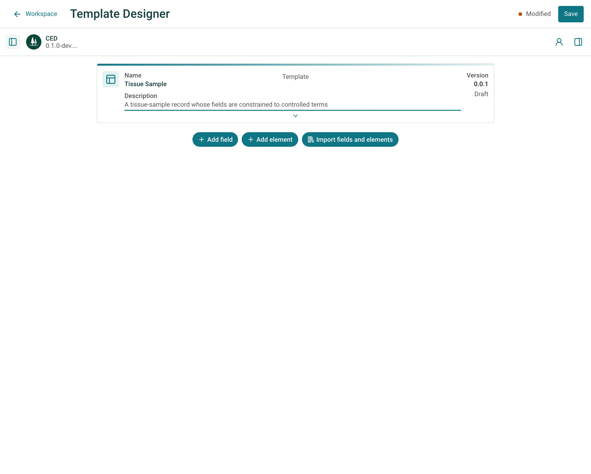

Use **Add field → Text** to add two ordinary text fields, `Sample ID` and
`Lab ID`, with no constraints. Not every field needs a controlled vocabulary; a
local identifier is just a string, and forcing it into an ontology would help
no one. These two fields also give the template some context before the controlled
fields.

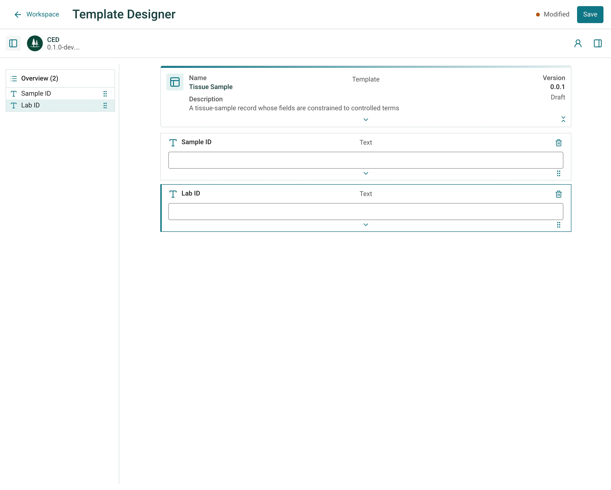

## Field 1: Cell Type, Bound to a Whole Ontology

The first controlled field is `Cell Type`. Every value it should ever hold is a
cell type, and there is a single ontology whose entire purpose is to name cell
types: the Cell Ontology. When an ontology's whole scope matches your field, the
simplest and most complete constraint is to bind the field to all of it.

Choose **Add field → Controlled Terms** and name the field `Cell Type`. Expand
its settings using the chevron, select **Constraints**, and click **Edit** beside
**Choose a vocabulary constraint**. The controlled-term picker opens. Its
**Terms**, **Branches**, **Ontologies**, and **Value sets** tabs let you choose what kind of
constraint to add. For this field you want a whole ontology.

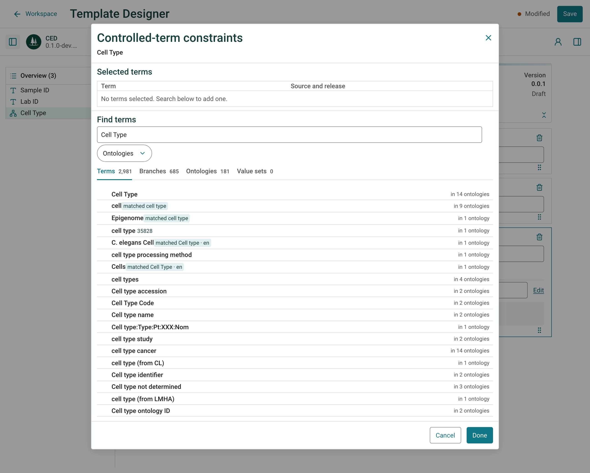

In **Find terms**, search for `Cell Ontology` and choose the **Ontologies** tab.
Find **Cell Ontology (CL)** among the results. The counts beside the results
refer to terms matching your search, not to the total size of each ontology. This
is the first point where judgment matters, and it matters more than a single clean
result suggests. BioPortal holds well over a thousand ontologies, and they vary
enormously in quality. Some are community standards: broadly adopted, actively
maintained, and carefully governed. Others are partial, stale, or one-off uploads
that almost no one else uses. Often several ontologies cover the same subject,
differing in scope, granularity, and how actively they are kept up. Choosing well
means preferring the ontology that is well maintained and widely used for your
subject, so the terms you commit to are ones others rely on too and will keep
resolving. For cell types that ontology is the Cell Ontology, part of the OBO
Foundry and used across biomedicine, which is why this field binds to it rather
than to some other collection that merely mentions cells.

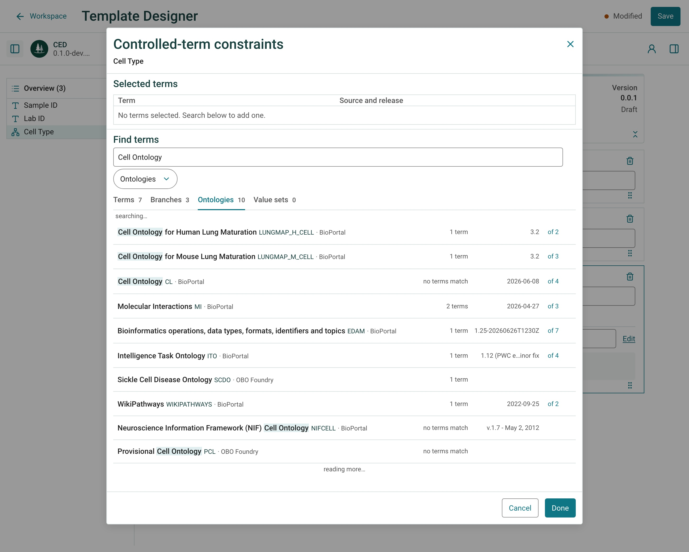

Click the **Cell Ontology** result with the acronym **CL**. The **Selected
ontology** panel identifies it, and the result expands to show its ontology IRI.
Click **Select** to add the whole ontology to **Selected terms**, then **Done**
to apply the constraint to the field.

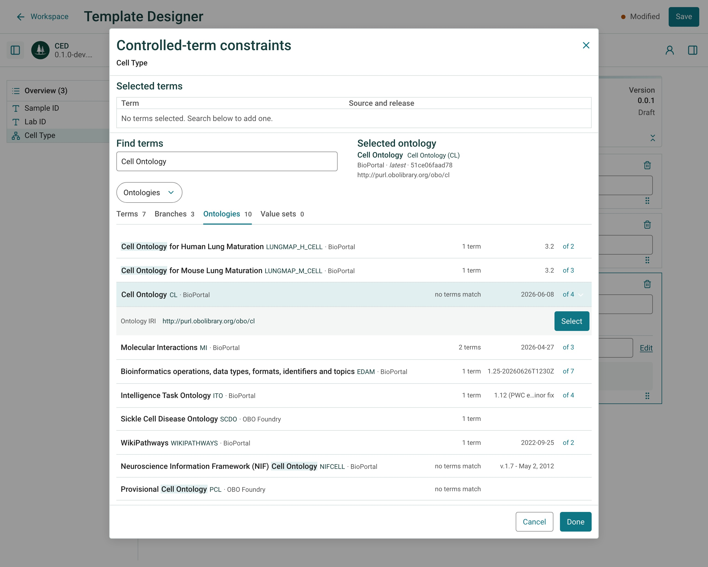

The **Constraints** tab now shows the field bound to the entire Cell Ontology
(source CL). Terms from that ontology are allowed values; terms outside it are
not.

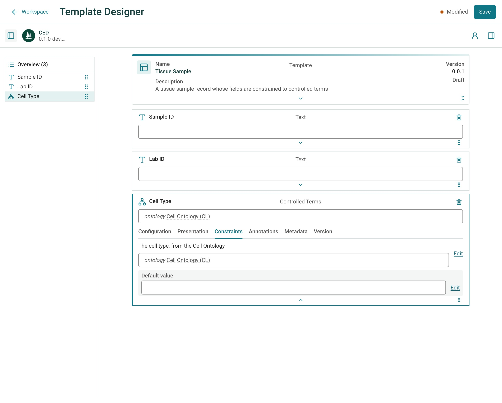

## Field 2: Organ, Bound to a Branch

Binding a whole ontology works when an ontology is about exactly your field.
Often none is. An organ is a piece of anatomy, and any ontology broad enough to
define organs also defines much more: tissues, cells, body regions, whole
organisms. A field that should hold an organ cannot be bound to such an ontology
whole, because that would let someone enter a tissue or a cell as well. What you
want is a *branch*: the single class *organ*, together with everything beneath
it. Which ontology that branch lives in you do not assume in advance; finding it
is part of the work.

This field is also where finding the term takes real work, so it is worth doing
carefully. Collapse the Cell Type settings, add a **Controlled Terms** field
named `Organ`, and open **Constraints → Edit**. Search for `organ` on the
**Terms** tab. The result shows the problem with a bare term search: many
matches across many ontologies, with classes named variations of "organ".
Open the **Organ** result group to see the ontologies that use that label. The
same word means slightly different things in each, and you still need to choose
the right source.

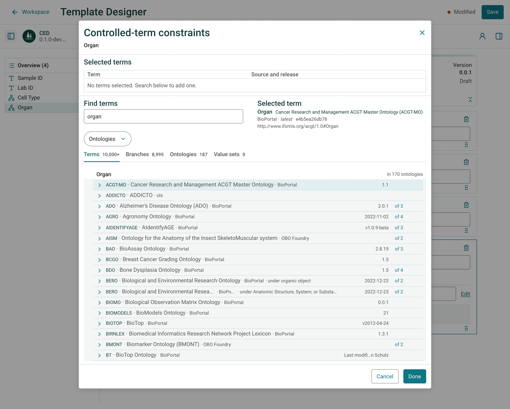

The way through is to recognize which of these ontologies is the one to trust for
anatomy and narrow the search to it. For anatomy that is Uberon, the Uber Anatomy
Ontology, an OBO Foundry standard used across biomedicine. Replace the text in
**Find terms** with `Uber Anatomy Ontology` and choose the **Ontologies** tab.
Open the **Ontologies** filter, check **UBERON Uber Anatomy Ontology**, and
click **Apply**. This keeps subsequent searches within Uberon.

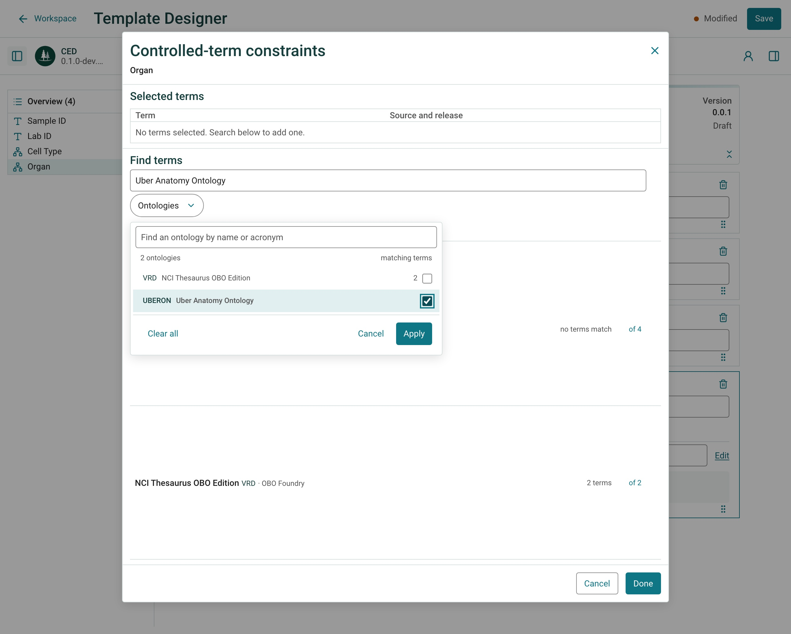

Change **Find terms** back to `organ` and switch to **Branches**. The query
now returns only Uberon branches. The concept you want is `organ`, with the
identifier `UBERON:0000062`. Beneath it
sit compound organ, sense organ, and the rest of the anatomy you would expect a
sample's organ to be.

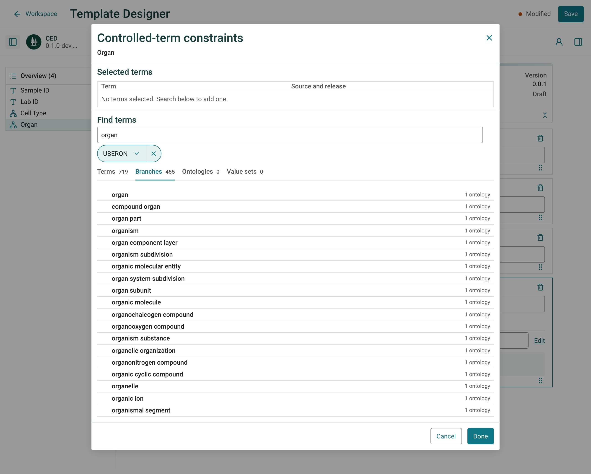

Open the **organ** result group and click its **UBERON · Uber Anatomy Ontology**
entry. The hierarchy opens. Check that **Selected branch** identifies
`UBERON_0000062`, then click **Select** and **Done**.

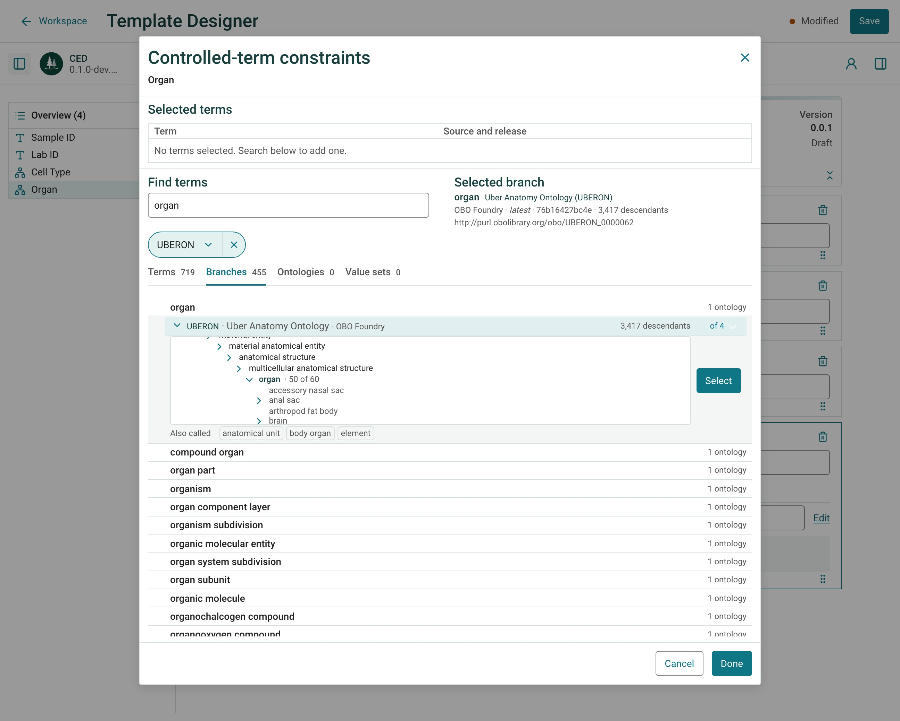

The field is now constrained to the organ branch of Uberon. A value must be that
class or one of its descendants, so the field accepts any organ and nothing that
is not one.

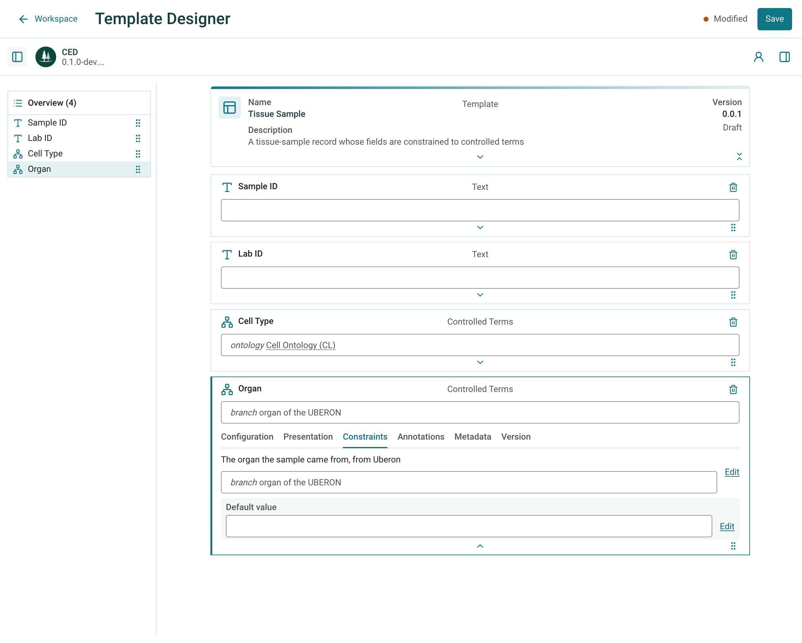

## Field 3: Assay Type, Assembled from Individual Classes

The last field takes the most manual work. Sometimes no single ontology or branch
captures the values you want to allow, and the right answer is to assemble the
constraint yourself, choosing individual classes one at a time. This template
should accept only a few specific assays, so rather than reuse an existing
grouping you name the exact terms.

Collapse the Organ settings, add a **Controlled Terms** field named `Assay
Type`, and open **Constraints → Edit**. Search for `histopathology assay` on
the **Terms** tab. Use the **Ontologies** filter to narrow to **OBI Ontology for
Biomedical Investigations**. Open the matching result group and click its
**OBI** entry to inspect the term.

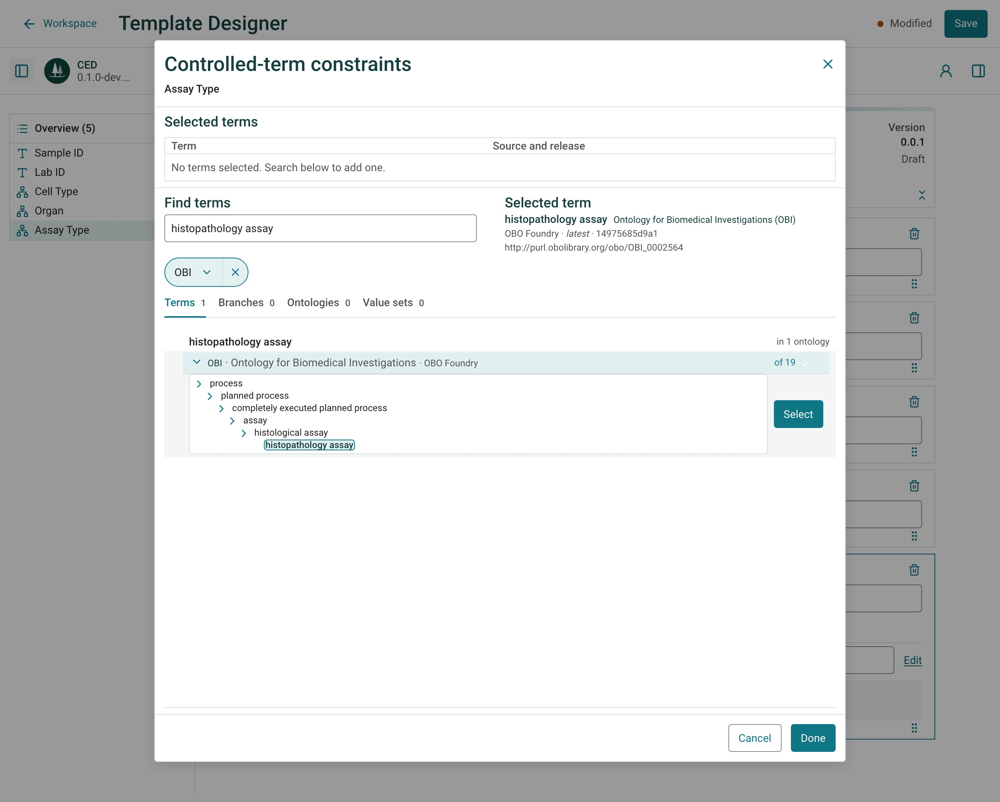

Click **Select**, then **Done**. One class is now on the field. To add the next,
click **Edit** to open the picker again and repeat.

Repeat for `imaging assay` and then `microscopy assay`. Each search contributes
one class. The **Constraints** tab now lists all three, assembled by hand into
exactly the set of assays this template permits. The classes need not come from the same
ontology; you could draw each from wherever it is best defined and combine them
on one field.

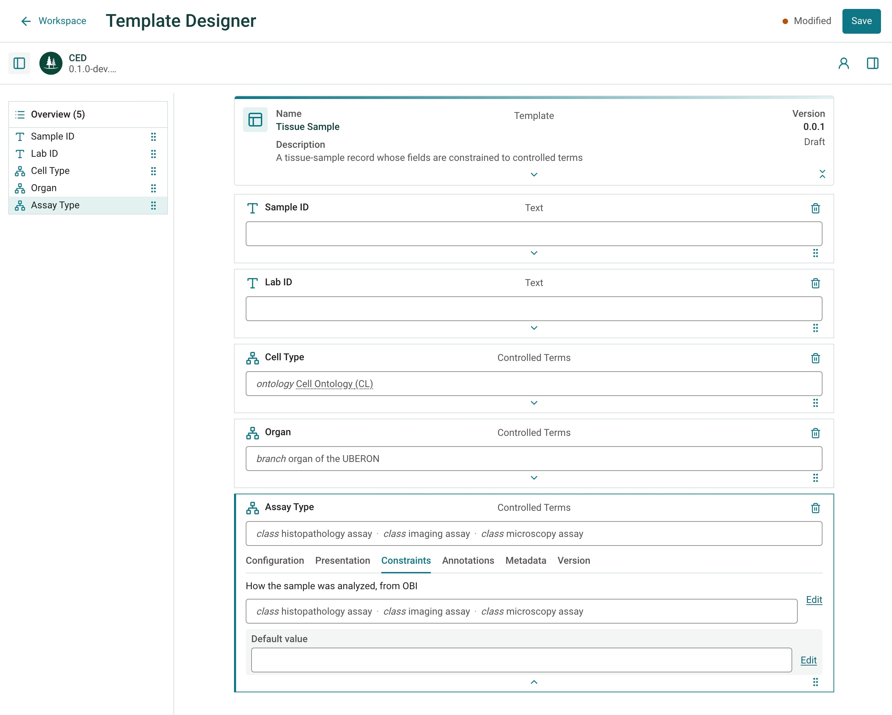

## Save

The template now has three controlled fields, each constrained a different way: a
whole ontology, a branch, and a set of assembled classes.

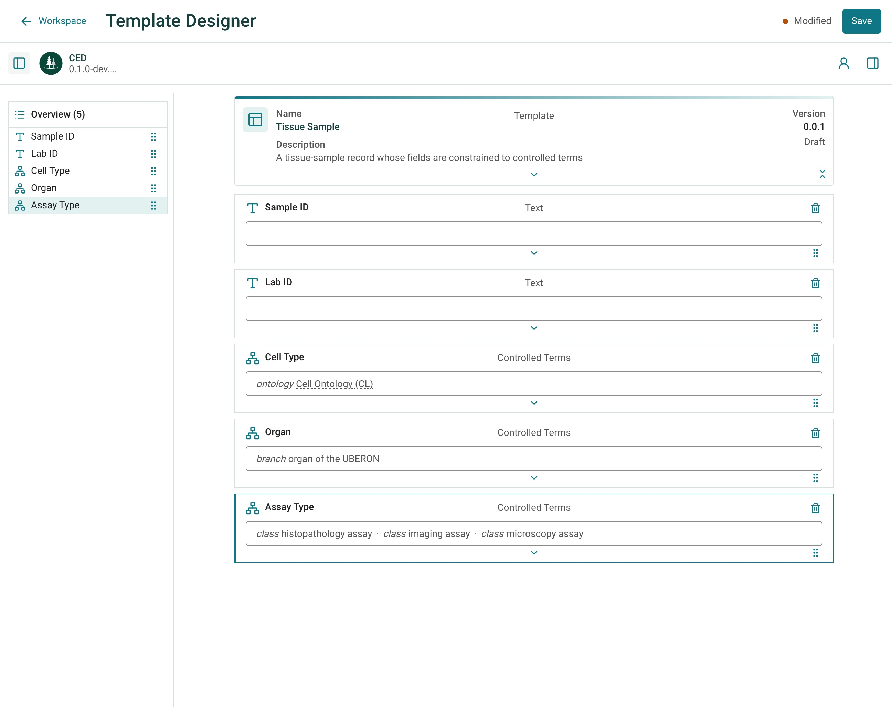

Click **Save**. When the status reads **Saved**, click **Workspace** to return
to your folder. The `Tissue Sample` template sits alongside anything else you
have built.

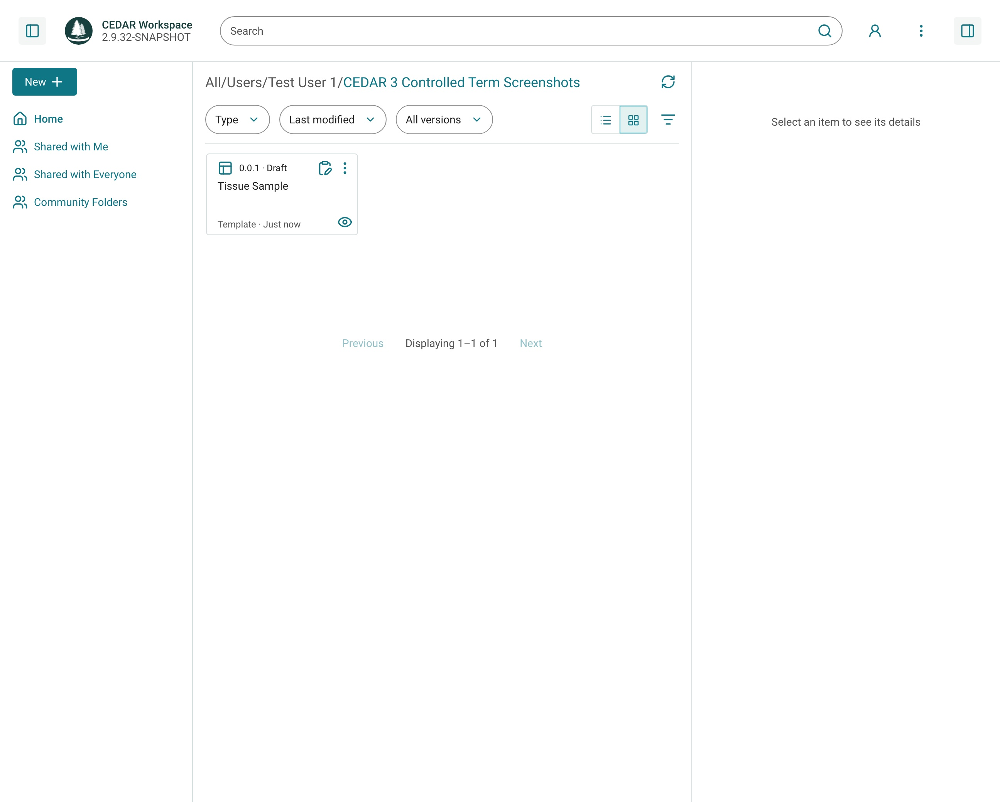

## Fill an Instance

A template is a blueprint. The metadata you actually collect are *instances* of
it, one per sample, and it is when you fill an instance that the constraints you
set earn their place: each controlled field becomes a guided picker that offers
only its allowed values. Open the template's **⋮** menu and choose **Populate**
to create one.

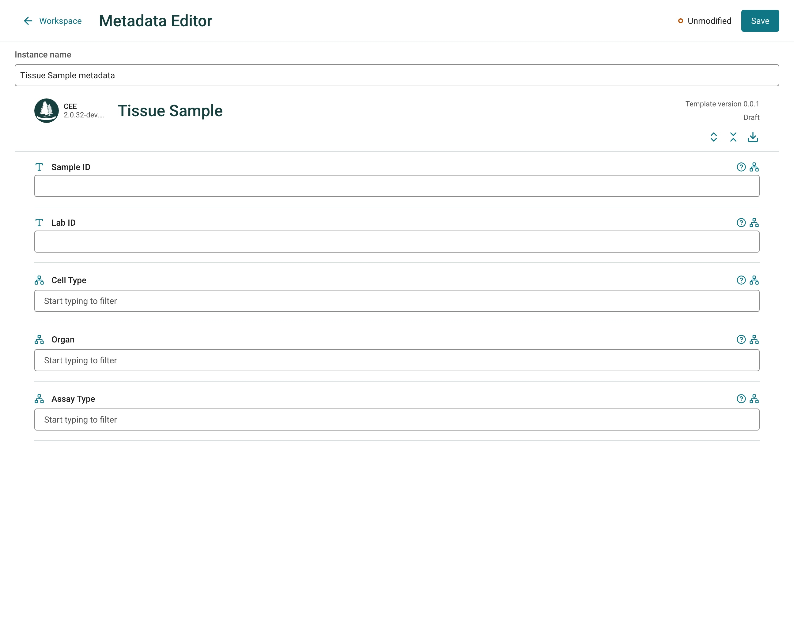

Sample ID and Lab ID are ordinary text, so you type them freely: enter
`TS-0001` and `LAB-0042`. The controlled fields behave differently. In Cell Type,
begin typing `hepat` and the field
offers *hepatocyte* and its neighbors from the Cell Ontology, and nothing from
outside it; choose *hepatocyte*. In Organ, type `liver` and the field offers
*liver* from the Uberon organ branch. Neither field will accept a value that is
not in the vocabulary you bound it to. Assay Type shows the constraint at its
tightest: you assembled it from exactly three classes, so it offers exactly those
three and nothing else.

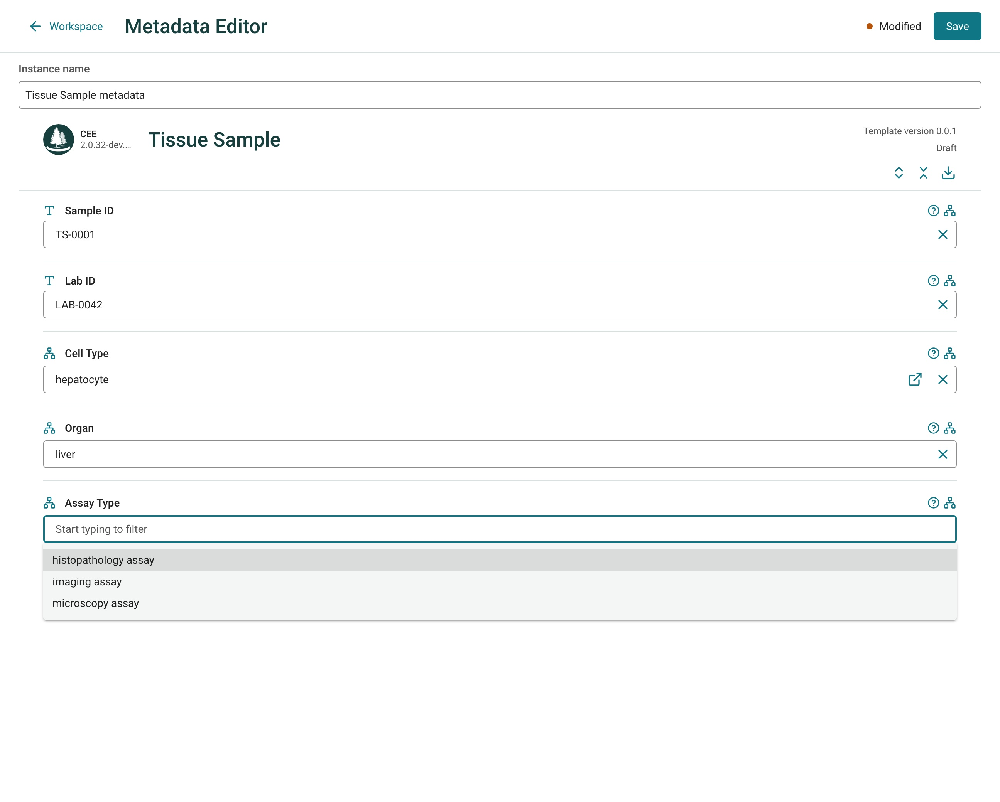

Choose *histopathology assay* and the instance is complete.

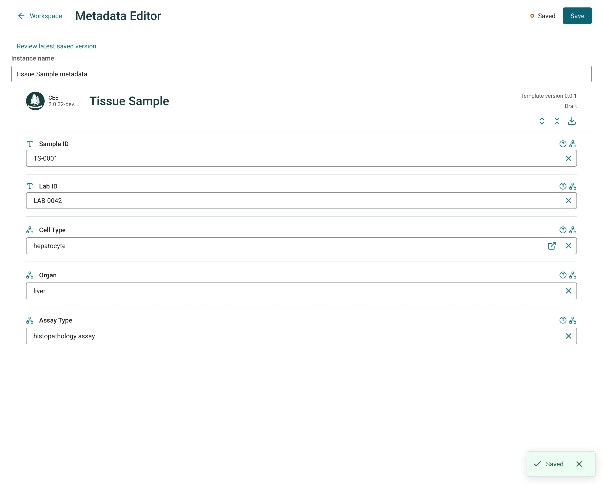

Click **Save** and wait for **Saved**. The instance carries the values you chose
not as text but as the ontology terms behind them, each with a stable identifier,
ready for anyone or any program
to interpret without guesswork.

## PFAS Value Sets

A value set is useful when your field should accept the members of an existing
list. For example, EPA Methods 533 and 537.1 each target a specific set of PFAS
chemicals. CEDAR uses EPA's Substance Registry Services (SRS) lists for membership
and CompTox for chemical identifiers, names, and synonyms.

This example has three optional fields:

| Field | Allowed Values | Distinct Chemicals |
| --- | --- | --- |
| PFAS Method 533 | [EPA Method 533 list](https://cdxapps.epa.gov/oms-substance-registry-services/substance-list-details/477) | 25 |
| PFAS Method 537.1 | [EPA Method 537.1 list](https://cdxapps.epa.gov/oms-substance-registry-services/substance-list-details/475) | 18 |
| PFAS Drinking Water | Both method lists together | 29 |

The lists overlap, so selecting both gives 29 distinct chemicals, not 43. EPA's
[comparison of Methods 533 and 537.1](https://www.epa.gov/sites/production/files/2019-12/documents/table_of_pfas_methods_533_and_537.1.pdf)
shows which chemicals each method includes.

### Select a Method List

Return to **Workspace**, choose **New → Template**, and name the template
`PFAS Test`. Add this description:

> Three optional chemical fields restricted to EPA Method 533, EPA Method 537.1,
> and both method lists together. Each selected value set links to its EPA list;
> selected chemicals link to CompTox.

Add a **Controlled Terms** field named `PFAS Method 533`. In its settings, leave
**Requirement** as **Optional** and enter this **Display description**:

> Choose a PFAS chemical from EPA Method 533 (25 chemicals). Search by name,
> synonym, CAS number or DTXSID.

Open **Constraints → Edit**, search for `PFAS`, and select the **Value sets**
tab. The results include both method lists and a combined list, each with its
membership count.

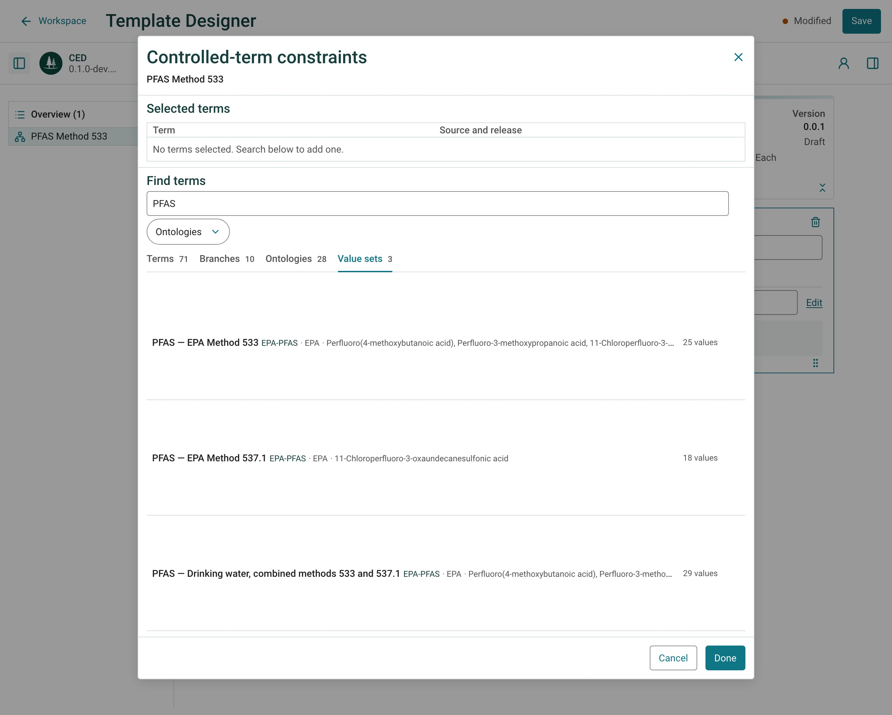

Click **PFAS — EPA Method 533** from **EPA-PFAS**. The **Selected value set**
panel identifies the list and its EPA source. Click **Select**, then **Done**.

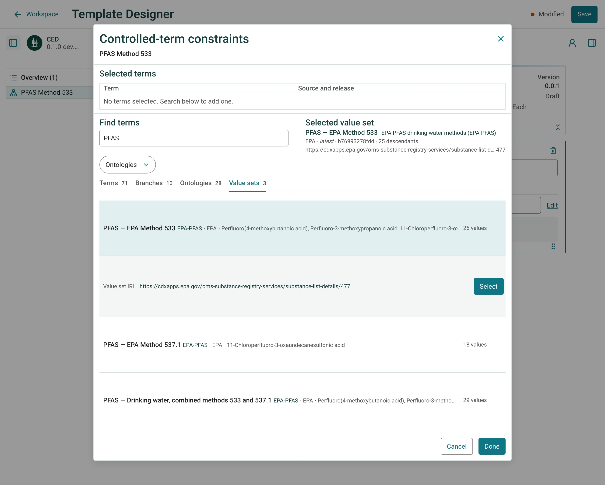

Add another **Controlled Terms** field named `PFAS Method 537.1`. Under
**Configuration**, set **Key** to `PFAS Method 537-1`, because a field key
cannot contain a period. Keep **Display name** as `PFAS Method 537.1` so the
form shows the method's correct name. Leave the field optional and use this
display description:

> Choose a PFAS chemical from EPA Method 537.1 (18 chemicals). Search by name,
> synonym, CAS number or DTXSID.

Open **Constraints → Edit**, search for `PFAS` on **Value sets**, and select
**PFAS — EPA Method 537.1**. Click **Select**, then **Done**.

### Combine Two Value Sets

Add a third optional **Controlled Terms** field named `PFAS Drinking Water`,
with this display description:

> Choose a PFAS chemical from either EPA Method 533 or EPA Method 537.1 (two
> selected value sets; 29 distinct chemicals). Search by name, synonym, CAS
> number or DTXSID.

Open its constraint picker and search for `PFAS` on **Value sets**. Select
**PFAS — EPA Method 533** and click **Select**. Then select **PFAS — EPA Method
537.1** and click **Select** again. Keep both rows in **Selected terms**, then
click **Done**. The field accepts a chemical from either list, with duplicates
offered only once. Selecting the two method lists separately also keeps a link
to each EPA list on the field.

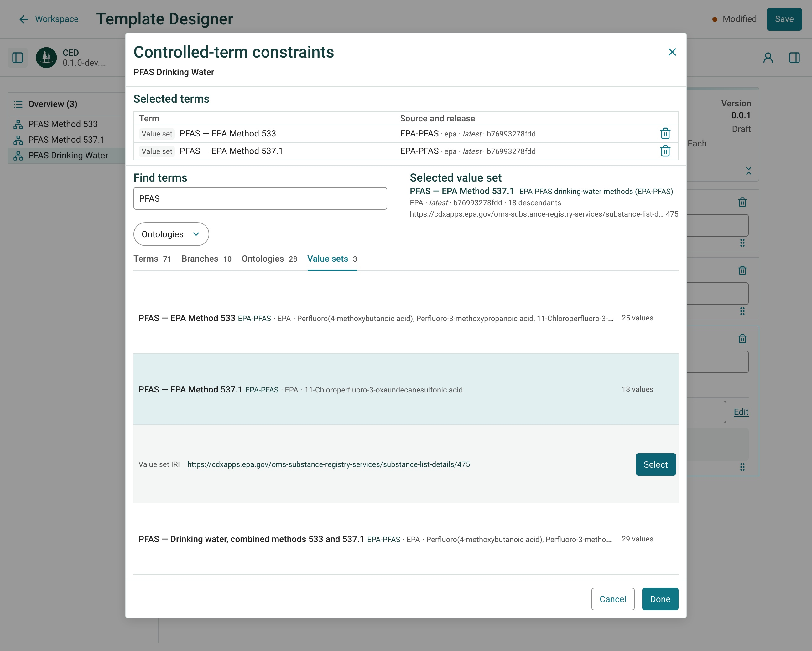

Collapse the field settings and click **Save**. Each value-set name links to its
EPA page, so you can inspect the source of the allowed values.

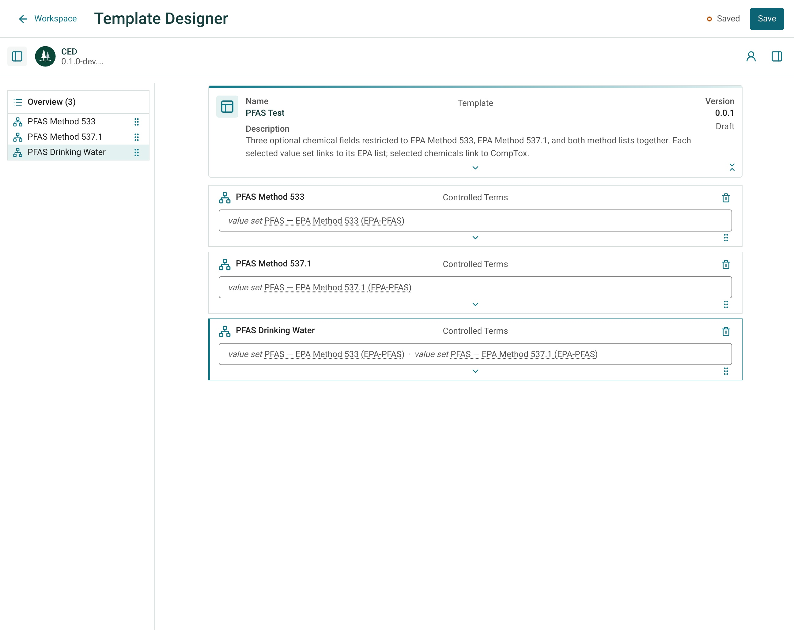

### Find and Select Chemicals

Return to **Workspace** and choose **Populate** from the template's **⋮** menu.
Each field searches only within its selected value sets. You can search by a
chemical's name, a synonym, its CAS number, or its CompTox DTXSID identifier.
For example, all four of these searches in **PFAS Method 533** find the same
chemical:

| Search By | Example |
| --- | --- |
| Name | `Perfluorooctanoic acid` |
| Synonym | `PFOA` |
| CAS number | `335-67-1` |
| DTXSID | `DTXSID8031865` |

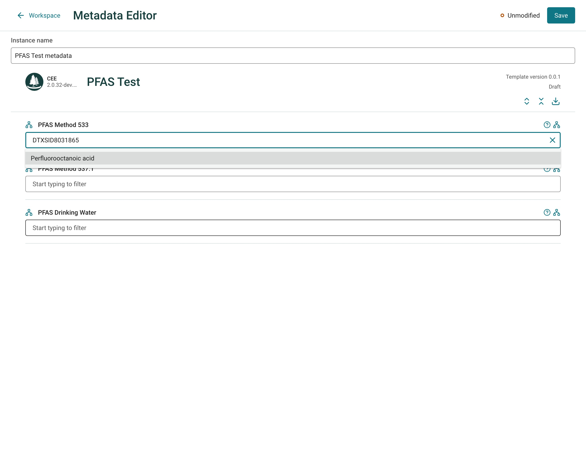

Select **Perfluorooctanoic acid** in **PFAS Method 533**. In **PFAS Method
537.1**, search for `PFOS` and select **Perfluorooctanesulfonic acid**. In
**PFAS Drinking Water**, search for `PFHxA` and select **Perfluorohexanoic acid**.
Click **Save** and wait for **Saved**.

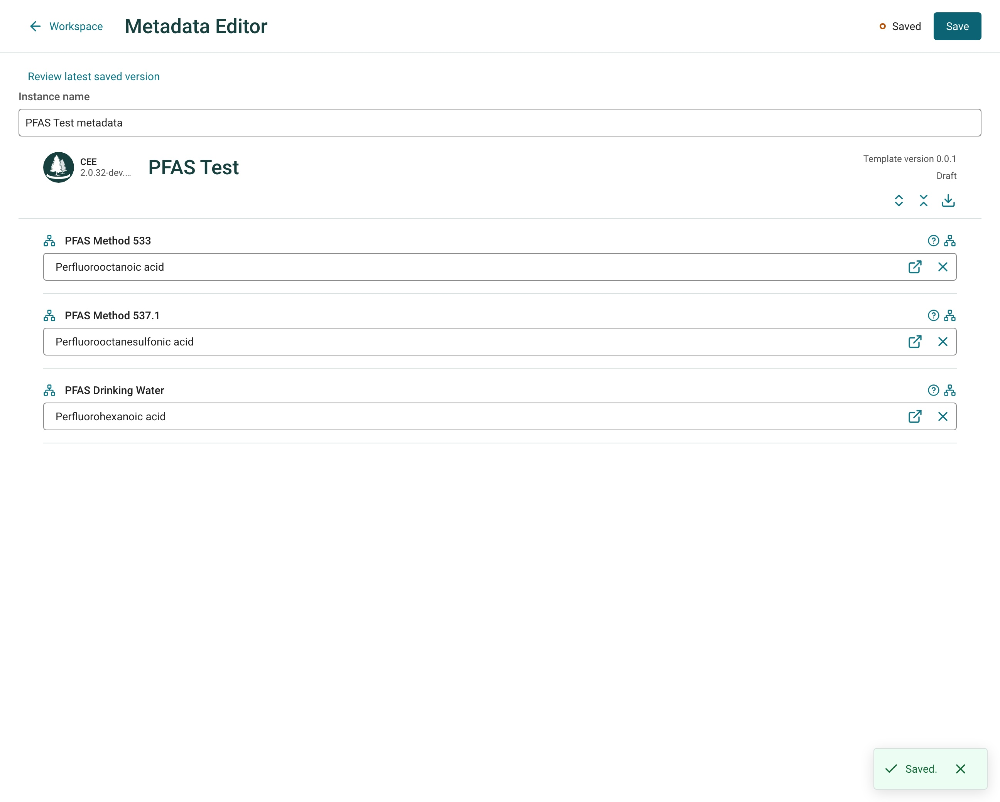

The external-link icon beside each selected chemical opens its CompTox page.
The value therefore carries a chemical identifier as well as the displayed
name, while the template records which method lists constrain the choice.

## Choosing a Constraint

Whichever approach you used, the result is the same in kind. The field no longer
accepts arbitrary text, only terms that already carry an agreed meaning and a
stable identifier. Which method to reach for is a question of fit: a whole
ontology when it is about exactly your field, a branch when only part of an
ontology applies, and assembled classes when nothing existing fits and you must
name the values yourself. Use a value set when an existing named list captures
the choices your field should allow, and combine lists when either one's members
are acceptable. None of them is automatic. The right terms have to be
found before a field can point at them. That work is what makes the payoff
possible: values that mean the same thing to everyone, drawn from vocabularies
you share rather than invent.
